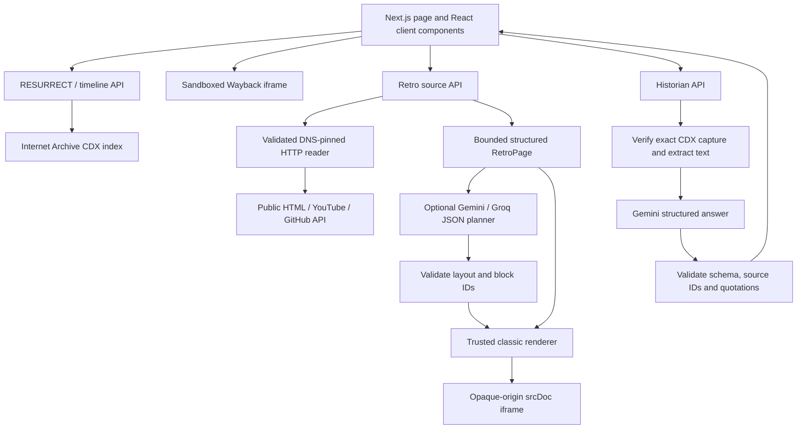

# Dead Internet: interview study guide

Source reviewed: commit `0f2bdab`. This is a study aid for explaining the actual
implementation, not a claim that every feature is production-ready. Open
`code-walkthrough.html` for the numbered source, file search, and explanations by
logical block. Read in request order rather than alphabetical order.

Verification during preparation (2026-11-21): 225 tests across 16 files passed;
project lint and the walkthrough generator's lint passed. Production compilation,
TypeScript and static generation completed, but `npm run build` exited with a
Next.js security advisory. `npm audit --omit=dev` independently reported one
moderate production vulnerability in Next.js, with 16.4.6 offered as a fix for the
installed 16.4.3. Treat a framework security upgrade and subsequent verification
as pre-demo maintenance; this guide does not claim a clean production build.
No application behavior or dependency versions were changed to prepare these notes.

The offline viewer includes 73 tracked source/config/test files and 4653 numbered
lines at the reviewed snapshot. Select a line number for its block explanation.
Rebuild it with `node scripts/build-interview-walkthrough.mjs` after future code changes.

## 1. The project in 60 seconds

Dead Internet explores historical websites and reimagines current public content
in retro layouts. RESURRECT finds a real Internet Archive capture near a requested
date. A timeline switches between monthly samples. MUTATE extracts current public
content and renders trusted retro templates, optionally using an LLM to select a
layout and feature existing content blocks. The 404 historian answers questions
using verified capture metadata and bounded archived text.

The important engineering boundary is provenance: an archived capture, a simulated
layout, and an AI interpretation are different products and are labeled separately.
The application does not train a model, recreate the entire historical Internet,
restore missing videos, or prove that an archived page's assets are complete.

## 2. What is AI, and what is application code?

| Capability | Runtime AI? | What actually happens |
|---|---|---|
| Date parsing and URL normalization | No | TypeScript checks input and uses UTC calendar rules. |
| Nearest historical snapshot | No | Wayback CDX supplies index records; code compares timestamps. |
| Timeline | No | CDX supplies monthly samples; code validates and sorts them. |
| Historical playback | No | The browser loads Wayback's rewritten page in an isolated iframe. |
| Saved time capsules | No | Browser localStorage stores up to 20 entries. |
| YouTube public data | No | Code parses public initial-page JSON without running source JavaScript. |
| GitHub public data | No | Code reads the public REST API and bounded file content. |
| Classic retro layouts | No | Authored HTML/CSS templates and local interaction scripts. |
| AI retro planner | Yes | Gemini, then Groq on failure, proposes layout + block IDs + rationale. |
| Applying/rendering an AI plan | No | Runtime validators accept known choices; trusted templates render them. |
| 404 answer | Yes | Gemini generates observations, inferences, and evidence gaps. |
| Citation validation | No | Code checks shape, source IDs, and quotation membership. |

**AI at development time is a separate question.** This project was developed with
substantial AI coding assistance; this conversation includes assistant-written
implementation, fixes, tests, and commits. Do not claim that you personally wrote
every line unaided. A Git author name is not evidence of who typed or generated code.

A truthful attribution statement is: "I developed this with AI coding assistance.
The assistant helped generate implementation and tests. I can explain the design,
trace requests, evaluate the tradeoffs, and demonstrate the behavior." Say the last
sentence only to the extent you can actually do it. Name your own product decisions,
manual changes, and verification work from your real experience; the repository
cannot establish an exact human-versus-AI percentage.

No model weights were trained or fine-tuned. This is model/API integration and
evidence-grounded generation. There is no embedding model or vector database:
evidence is retrieved deterministically using the selected URL and timestamp.

## 3. Architecture and trust boundaries

The external source page, the model response, and client request bodies are untrusted.
TypeScript types help the compiler; runtime validation handles these trust boundaries.
The iframe separates browser execution contexts. DNS/IP checks protect the server
that fetches arbitrary public URLs. They solve different problems.

## 4. Logical flow A: opening the application

1. `app/layout.tsx` imports global styles, sets metadata, and wraps child routes in
   `<html lang="en">` and `<body>`. This is shared page structure.
2. `app/page.tsx` returns the homepage `<main>` and `WebsiteApp`.
3. `components/WebsiteApp.tsx` is a client component because it uses React state.
   `mode` selects archive or retro. Both workspaces remain mounted inside `hidden`
   containers, preserving their state when tabs change. Tradeoff: hidden components
   remain alive and effects may continue running.
4. Each feature component owns its UI state; API handlers own server operations.
   No Redux store or database is needed for this prototype.

Interview checkpoint: explain the difference between server rendering and the
`"use client"` boundary. Client components can still have initial server-rendered
markup; the directive identifies client-side code and hydration requirements.

## 5. Logical flow B: URL + date -> real archive

Read these files in order:
`ResurrectForm.tsx` -> `ResurrectApp.tsx` -> `api/resurrect/route.ts` ->
`validation.ts` -> `wayback.ts` -> `SnapshotMeta.tsx` -> `SnapshotFrame.tsx`.

### Form and controller

- Form state holds URL, date, and inline error. `preventDefault()` keeps form
  submission inside React. `disabled` prevents duplicate submissions.
- `normalizeUrl` and `parseRequestedDate` validate before invoking `onSubmit`.
  The date input currently uses a full-date calendar, while the shared parser/API
  also supports a year or year-month.
- `handleResurrect` enters loading, records the original request, clears the old
  result, and POSTs JSON. The browser stops waiting after 60 seconds.
- A successful JSON result is stored. Network/JSON failures become a structured
  unavailable state. `finally` completes the loading phase on either outcome.
- JSX branches on `response.status`. The `found` discriminator lets TypeScript
  know that snapshot and playback fields exist in that branch.

### API and validation

- The route parses `request.json()` into `unknown`, checks field types, calls the
  archive service, and maps domain errors to JSON/HTTP statuses.
- HTTP 200 with `no_snapshot` means the lookup completed but had no result.
  Invalid input is 400; upstream archive failure is 502. HTTP status and business
  status carry different information.
- URL normalization supplies historical `http://` when no scheme exists, rejects
  unsupported protocols and embedded credentials, requires a dotted hostname, and
  strips the fragment because it is not sent in an HTTP request.
- Date parsing accepts a restricted format, checks bounds, constructs a UTC date,
  then compares its year/month/day back to the input. JavaScript otherwise silently
  normalizes February 31 into March.

### The nearest-capture algorithm: `lib/wayback.ts`

The source explorer shows every numbered line. These are the important statements:

| Lines at reviewed commit | Reasoning |
|---|---|
| 1-11 | Import shared validation, response types, domain errors, TTL cache, abortable sleep. Re-exports preserve older import paths. |
| 13-31 | Fixed archive endpoints; six-month window; 15-second individual fetch timeout; CDX row shape; shared 15-minute cache. |
| 38-49 | Slice a capture's UTC timestamp into year/month/day/hour/minute/second; pad date-only inputs for helper callers. |
| 52-59 | Format CDX dates and exact second-precision timestamps. |
| 61-66 | Move calendar months using day 1, then clamp to the destination month's last day. |
| 69-85 | A Set preserves the original URL and adds the with/without-www fallback without duplicates. |
| 88-93 | Build iframe `if_` URL and canonical provenance URL separately. |
| 100-135 | Parse CDX array-of-arrays using header positions rather than assuming column order. |
| 138-174 | Injectable fetch options; combine caller cancellation and timeout; retry 429/503 once. |
| 183-211 | Build encoded query parameters; append both filters rather than overwriting one; validate HTTP and JSON. |
| 218-239 | Filter HTML/200 candidates, compute absolute millisecond distance, keep the smallest, break equal distances toward the earlier timestamp. |
| 264 onward | Normalize inputs, construct inclusive window, start a 45-second total deadline, try variants, fetch two candidates, cache complete results, build metadata. |

Let target time be `t`. For one exact URL's chronologically ordered captures, every
capture before `t` is no closer than the latest capture before `t`; every capture
after `t` is no closer than the earliest after `t`. Therefore only those two
candidates need comparison. The app requests `limit=-1` before/at the target and
`limit=1` after/at the target in parallel.

Example: requested midnight June 15. Captures June 14 00:01, June 14 23:59:59, and
June 15 01:00. Daily collapse could keep June 14's first capture and lose the best
one. The correct result is June 14 23:59:59, one second away.

Cache keys contain URL, target timestamp, window, and algorithm version. Omitting
the target would incorrectly reuse nearest candidates for a different requested day.
Both parallel requests must succeed before caching; a partial result is not evidence
that the true nearest candidate was checked.

Important limits: this is nearest **within +/-6 months for the first URL variant
with results**, not a global search across every archive and every alias. Constant
response size does not make the Internet Archive's internal search constant time.
`distanceDays` rounds elapsed days; zero can mean less than 12 hours, not the same date.

### Rendering and timeline

`SnapshotMeta` labels requested and actual dates, range, URL, HTTP status, and source.
`SnapshotFrame` stores static mode and retry count in an outer component. Its child
key combines URL/mode/attempt, so each retry remounts the iframe and resets its timer.
The outer static-mode choice survives capture switches. Interactive archives allow
scripts but never same-origin or top navigation; static mode allows no sandbox powers.
A cross-origin iframe load event is not proof of a correct historical render.

`CaptureTimeline` aborts an older request before starting another and avoids applying
cancelled results. The server accepts one year, collapses only for this overview to
one capture per month, validates rows, sorts them, removes duplicate months, and
returns at most 12 samples. Selecting one updates metadata and playback together.
Errors retain the current snapshot. This samples a year; it does not list all captures.

`TimeCapsules` subscribes to localStorage with `useSyncExternalStore`, using an empty
server snapshot for hydration. The custom event updates the same tab; the storage
event updates other tabs. Reopening performs a date-based lookup; it does not promise
to reopen the exact stored second. Storage errors are visible. No backend persistence.

## 6. Logical flow C: public website -> retro experience

1. `RetroApp` holds engine, era, layout, content mode, current page, and request state.
   AI is the current default; classic can be explicitly selected.
2. `convert` aborts the older request, calls `/api/retro` or `/api/retro/ai`, validates
   the result discriminator, and preserves the previous preview on failure.
3. `/api/retro` validates input, detects the platform, and selects public data or
   explicit sample content. It never substitutes fake samples after a public failure.
4. Generic pages go through `fetchPublicPage` and `extractRetroPage`. Supported
   YouTube/GitHub pages use dedicated adapters. Public Facebook feeds are unsupported.
5. The result is a `RetroPage`: source URL, title, text blocks, links, retrieval time,
   truncation flag, and optional platform or AI metadata. It is not executable source HTML.
6. `useMemo` renders an isolated HTML string when the page/style changes. Merely
   switching theme reuses content and does not call a model or refetch the page.
7. `srcDoc` loads the trusted output into a sandboxed iframe, with explicit SIMULATED
   labels. Generic/AI text templates have no scripts. Platform remakes allow a fixed
   local script for search/navigation/likes, never the source website's JavaScript.

### Why the HTTP reader is deliberately complicated

An attacker can submit a URL that points at localhost, a private network, or a cloud
metadata endpoint. Checking only the text "localhost" is insufficient. The code:

- Parses HTTP(S) URLs, rejects credentials and custom ports, strips fragments.
- Resolves DNS and rejects any non-public address, including mapped forms.
- Pins the validated IP in the actual socket lookup while retaining the hostname for
  HTTP Host/TLS. This reduces DNS-rebinding/time-of-check-time-of-use exposure.
- Repeats URL, IP, and optional service-host checks after each redirect; at most four
  redirects are followed, meaning at most five response attempts.
- Rejects unsupported MIME/encoding and counts actual streamed bytes, not just the
  untrusted Content-Length header. Generic HTML is capped at 1.5 MB, YouTube 5 MB,
  GitHub API JSON 1 MB. A request has a 20-second reader deadline.

These are layered protections, not a claim of a complete security audit. Origin
checks on selected APIs are also not authentication or protection against direct callers.

### Content extraction and platform adapters

Cheerio parses HTML without executing scripts. Extraction removes active/hidden
elements, keeps bounded semantic text and safe HTTP(S) links, prefers main/article,
and rejects unusable browser-check/JavaScript-only content. It is an allowlisted
data projection, not a full visual website clone or a generic HTML sanitizer.

YouTube's `initialJson` scans braces while respecting JSON strings/escapes and calls
`JSON.parse`, never `eval`. An explicit stack walks known renderer shapes, skips ad
subtrees, validates IDs, deduplicates with a Set, and returns at most 18 videos.
The public page format is brittle and can change. Watch links open YouTube; this is
not a full embedded video player. The scanner can rescan suffixes for repeated
malformed assignment matches, so a blanket worst-case O(n) claim would be inaccurate.

GitHub uses public repository metadata and contents APIs. It returns at most 100
entries plus one optional README or selected text file, not every file recursively.
Binary/large files receive an explanatory placeholder. Anonymous rate limits apply;
branch names with slashes are not fully resolved for every non-default branch.

Public content caches for two minutes and preserves the original retrieval time.
Local stars/likes/posts are demonstrations, not external account mutations.

### Model planning versus executing generated code

`/api/retro/ai` first reuses the ordinary source-reading pipeline. `aiRebuild` converts
platform data to bounded text, reserves budget, and asks Gemini for a JSON plan.
Only the first 40 blocks and short navigation labels enter the prompt. On provider
or plan failure it tries Groq; if planning still fails, the route returns the retrieved
content with an explicit classic-fallback notice.

The plan contains exactly `layout`, `featuredBlocks`, and `rationale`. Runtime checks
enforce one of three known layouts, at most eight unique in-range integer IDs, and
bounded rationale. `applyRetroPlan` reorders existing source blocks; it does not accept
model HTML, CSS, JavaScript, URLs, or replacement page text. The model's rationale is
generated prose and may be imperfect even when its shape is valid.

`normalizeAiPage` removes platform-specific remake metadata and constructs text/links,
so an AI-planned result uses the generic trusted renderer, not the interactive platform
template. The planner is a constrained decision maker, not an autonomous coding agent.

For interactive platform previews, messages cross the opaque iframe boundary. The
parent checks the exact `event.source` window and validates the small action payload.
It cannot rely on a useful normal origin for this sandbox. Public actions only construct
supported YouTube searches or HTTPS GitHub URLs; subsequent reads repeat server validation.

## 7. Logical flow D: selected capture -> 404 answer

1. The UI passes original URL, requested date, and actual capture timestamp. Changing
   capture changes the historian component key, clearing obsolete context/state.
2. Availability GET exposes enabled/configured status and model name, never keys.
   Evidence review works without a paid model call.
3. The POST reader checks same-origin when supplied, streams at most 8192 bytes,
   parses an object, validates the capture and a 1-1000 character question.
4. `loadHistorianEvidence` rechecks the exact timestamp against CDX. A client-supplied
   timestamp alone is not trusted. It obtains raw archived HTML through the bounded
   reader at a fixed Wayback host, and excludes text if the capture identity changes.
5. `archivedText` strips active/UI elements and produces bounded chunks. Failed text
   retrieval can degrade to verified metadata-only evidence with explicit limitations.
6. The evidence pack assigns source IDs E1, E2, etc. Canonical links are built by code.
   No model invents provenance URLs. Evidence caches for ten minutes.
7. `askGeminiHistorian` checks configuration, hashes prompt version/model/question/
   evidence for a five-minute answer cache, and reserves process-local budget.
8. The SDK performs token preflight (8000 maximum), requests JSON under a schema,
   limits output (2048 tokens), and accepts only a completed response.
9. Runtime validation checks exact fields/counts, known evidence IDs, and quote
   membership after whitespace normalization. Fabricated quotations cause rejection.
10. The UI renders observations, explicitly labeled inferences, and gaps separately,
    with excerpts, source links, generation time, cache status, and token usage.
11. `finally` releases the concurrency reservation even when a provider fails. Error
    translation avoids forwarding provider diagnostics containing sensitive details.

**The critical limitation:** a quote can be real but the claim about it can be wrong.
The validator checks traceability, not semantic entailment or historical truth.
Prompt instructions mitigate prompt injection; they do not mathematically eliminate it.
One text capture cannot establish a website's full history, appearance, or cultural impact.

## 8. Complexity: distinguish local work from remote latency

Let n be candidate captures, C cache entries, B input bytes, D DOM nodes, h DOM depth,
k text blocks, f featured blocks (at most 8), m timeline rows, q answer claims, and S
total evidence characters. Limits bound ordinary requests but do not erase algorithmic cost.

| Operation | Time | Additional space / caveat |
|---|---|---|
| URL/date input processing | O(input length) | O(input length); calendar fields are fixed-size. |
| CDX JSON parsing | O(n) for a fixed column schema | O(n) row objects; JSON parsing is also proportional to payload bytes. |
| `selectClosestSnapshot` | O(n) | O(n) from `.filter`, then O(1) accumulator; could avoid the filtered copy. |
| Normal RESURRECT response processing | Small bounded candidate set | Two candidates per exact variant; at most two variants. Retry can double HTTP attempts. Archive server lookup cost is unknown. |
| Cache `get` | Expected O(1) | One Map lookup; checks the requested entry's TTL. |
| Cache `set` / `size` | O(C) | Prunes all entries; cache space O(C * value size). FIFO by insertion/overwrite order, not LRU. |
| Timeline sorting | O(m log m) | O(m); query normally returns at most 13 rows before cap/dedup. |
| HTTP body buffering | O(B) | O(B), with copies during Buffer.concat; total per request bounded by policies. |
| HTML extraction | At least O(B + D), plus selector/text work | O(B + D) DOM memory. Ancestor checks can add O(D*h); avoid claiming all Cheerio operations are guaranteed linear. |
| YouTube JSON traversal | O(nodes + inspected properties) for traversal | O(parsed JSON + explicit stack); visit cap 150000, output cap 18. Assignment extraction can be worse on malformed repeated matches. |
| GitHub contents processing | O(entries + decoded file bytes) | Bounded listing/file preview, not recursive clone complexity. |
| Trusted rendering | Roughly O(text bytes + k + links) | O(output HTML bytes); fixed template/CSS cost. |
| Applying retro plan | O(k*f + k) as written | O(k); `.includes` scans the selected list. Since f<=8, practically linear in k. |
| Historian cache-key hashing | O(serialized prompt/evidence bytes) | Serialization also allocates that string. |
| Quote validation | Approximately O(q*S), plus string-match cost | Bounded q/excerpts; repeated source search/normalization could be precomputed. |
| Model request | Provider-dependent | Dominated by network, input/output tokens and inference. Do not assign a fake local Big-O or fixed latency. |

Parallel requests reduce waiting from roughly Lbefore + Lafter to max(Lbefore,Lafter),
plus overhead. They do not reduce the number of remote requests or guarantee low latency.
There are no benchmarked p95, throughput, uptime, cost-savings, or accuracy numbers in
this guide. Do not invent percentages or claim tests establish production performance.

## 9. Design decisions and their tradeoffs

| Decision | Why it fits | Tradeoff / next step |
|---|---|---|
| Next.js monolith | UI + backend boundaries in one deployable project | Scaling/security policies need explicit production work. |
| TypeScript discriminated unions | Make legal result states clear to UI and compiler | External JSON still needs runtime validation. |
| API-side archive lookup | Centralizes validation, cache, retries | Adds a server dependency; CDN/egress behavior matters. |
| UTC dates | Prevent local timezone changes from moving captures | UI must label times; rounded days can surprise users. |
| Closest-before/after | Exact local comparison with tiny results | Relies on archive query semantics and availability. |
| Process-local TTL Map | Simple prototype; no database setup | Not shared, durable, or a global cost cap; restart loses state. |
| Shared validators | Consistent form/API behavior | Different URL policies still apply to archive index vs server-side fetching. |
| Sandboxed iframe | Isolates untrusted archive scripts and generated preview | Incomplete cross-origin visibility; some source functionality breaks. |
| Structured content model | Reuse content across themes and providers | Extraction loses source styling, forms, media and JS app behavior. |
| Plan JSON, not generated HTML | Constrain model authority; auditable rendering | Less creative freedom; three authored compositions. |
| Evidence beside answers | User can inspect source support | Genuine quotation does not prove interpretation. |
| Explicit provider/classic fallback | Keeps a usable preview when AI fails | Failure reason details can be obscured; fallback needs visible labeling. |
| Keep old preview on failure | Failed optional actions do not destroy useful content | Needs careful request cancellation and stale-result handling. |

## 10. Improvements actually made (Git evidence)

| Commit | Change and the engineering lesson |
|---|---|
| `a5fb1ff` | Reset snapshot state on URL changes; fresh Response mocks and object-shaped test fixtures. Test doubles must match real API semantics. |
| `51334ae` | Remove incompatible Next runtime config; reject normalized invalid dates; bound cache; fix load notice; add archive pagination. Build checks catch framework constraints. |
| `1559c2b` | Add archive retries and reduce query volume with a narrower window/daily collapse. This helped volume but introduced accuracy tradeoffs. |
| `dce0925` | Replace exhaustive paging/daily collapse with exact before/after queries, six-month range, month clamping and total deadline. Improve the algorithm rather than hide the tradeoff. |
| `66cb6f3` | Shared validation, playback retry and static safe mode. Recovery is a feature. |
| `e865fb5` | Timeline, isolated retro remakes and public platform data. Different data sources need explicit adapters and trust boundaries. |
| `ad52ab1` | Grounded historian proof of concept; evidence validation and model boundary. Generated claims need visible limits. |
| `f4c5c0b` / `b999708` | Expeditions, local capsules, popular sites, calendar shortcuts. Reduce effort to reach a meaningful demo. |
| `4678ecf` / `0f2bdab` | AI retro planning, Groq fallback, classic fallback and visible distinction between planned and classic layouts. Availability must not become false provenance. |

These commits establish repository evolution, not personal authorship or measured business
impact. Be ready to show a failing case and the fix, not just recite commit messages.

## 11. Honest next improvements

1. Shared rate limits and budgets across instances; authenticated abuse controls where
   needed. Current six/minute, two-active, daily counters reset per process and are
   shared between historian and planner. One reservation can include multiple provider
   API calls; this is not a precise billing meter.
2. Cache request coalescing, cache-key/version policy, and a distributed cache if measured
   traffic justifies it. Cache misses currently can duplicate concurrent upstream work.
3. Recorded browser regression tests with controlled fixtures for state transitions,
   stale requests, retry/static mode, opaque iframe messaging and fallback presentation.
4. Tighten runtime CDX header/timestamp validation in RESURRECT. Timeline/historian
   validate timestamp round-trips more strictly than the basic nearest helper.
5. Honor both Retry-After seconds and HTTP-date format. Current code handles numeric
   values only and caps the delay at ten seconds; avoid claiming full compliance.
6. Consistent byte limits and cancellation on every API. Historian/AI POSTs stream
   bounded bodies; basic archive/retro routes call request.json without that byte cap.
   RESURRECT currently does not forward request.signal to the service, although the
   service has an internal overall deadline.
7. Grounding evaluation with adversarial/irrelevant quotes and answer relevance checks.
   Distinguish correct citations from supported claims. Add multi-capture evidence
   before making evolution claims.
8. Review fixed CSP nonce strategy, UI isolation and message scope as part of a security
   review. A fixed nonce should not be described as a random per-response secret;
   escaping and sandboxing remain essential.
9. AI style changes currently restyle an existing plan without re-planning. Make that
   explicit or offer a deliberate replan action. Preserve local preview state only
   where the product promises it; remounting clears demo likes/saves.
10. Decompose long renderer/template lines; repair stale README/checklist statements.
    README still describes AI Mutate as design-only in one section despite implemented
    planning routes. Documentation is not stronger evidence than executable code.
11. Add structured, privacy-aware latency/error/fallback/cache metrics; benchmark before
    selecting scaling targets. A possible AWS deployment is a future design, not a
    currently implemented Amazon service integration.

## 12. Demo order and discussion prompts

1. Find YouTube around June 2007. Explain requested vs captured date, exact lookup and
   provenance. If Wayback fails, show the honest error/recovery and the mocked tests.
2. Switch one timeline sample, then static mode/retry. Explain why both metadata and
   iframe must change together and why missing assets stay unknown.
3. Classic-retro a public page or public GitHub repository; distinguish actual source
   content from the simulated layout. Demonstrate local-only interactions if present.
4. AI-rebuild the page. Point to provider/layout/rationale and the validator. If AI is
   unavailable, show the classic-fallback label; do not describe fallback as AI success.
5. Review historian evidence before asking a question. A generated answer should show
   quotes and limitations; metadata-only evidence should not claim visual knowledge.

Do not run a live demo with secrets on screen. Show `.env.example` variable names,
not `.env.local` values. Live provider availability/model access is not established
by a hardcoded model name or mocked SDK test. No paid model call was made for this guide.

Practice answering without reading:

- Why are two archive candidates sufficient? What assumptions make that proof work?
- How does daily deduplication break exact-nearest selection?
- Why does browser CORS not solve server-side SSRF?
- What race does DNS pinning prevent? Why repeat checks on redirects?
- Why not render model-generated HTML? What authority does the model actually have?
- How can an answer pass quote validation and still be wrong?
- What changes when this app runs on ten server instances?
- What fails when JavaScript is disabled or the archive sends an error page?
- Which parts were generated with coding assistance, and which decisions did you
  personally make and verify? Use concrete examples, never an invented percentage.

For behavior-oriented discussion, use your actual Situation/Task/Action/Result.
Good material here includes correcting the archive query tradeoff, maintaining clear
provenance, and preserving a usable preview under upstream failures. State only
results you observed; testing 225 cases is not proof of 225 real-world workflows.
